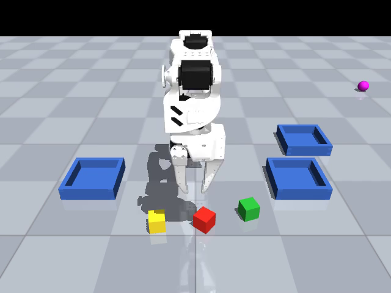

# Multi-strategy embodied sorting

**SO-ARM100 多策略物料分拣工作站**：统一仿真、感知、动作协议与执行器，
支持策略独立执行，以及视觉、世界模型 MPC、IK 在同一控制链中分段协作。



SO-ARM100 in a single MuJoCo workcell: scripted expert, RGB-D + IK, ACT,
SmolVLA, reinforcement-learning skill environments, and a learned-dynamics MPC
controller. Three colored materials are sorted into three assigned trays.

This project builds on Ahmed Sohail Butt's WorkCell A–D. Upstream commits are
pinned in `upstream.lock.json`; see `NOTICE` for attribution and modifications.
Measured M1 results and failures are recorded in `docs/RESULTS.md`.

## Measured M1 results

| Capability | Result |
| --- | --- |
| Scripted expert / RGB-D + IK / hybrid sorting | 20/20 complete scenes each |
| Learned world-model Reach | 20/20 targets; selected model trained on 8,000 transitions |
| Pretrained ACT / SmolVLA, original pick-and-place | 20/20 / 18/20 |
| Pretrained ACT / SmolVLA, sorting transfer | 0/5 / 0/5; needs task-specific training |
| SAC Reach and Lift | 4,096 training steps each; update and checkpoint checks passed; 0/5 task success each |
| LeRobot demonstrations | 10 episodes, 1,280 frames, export and readback verified |

These are fixed simulation regression cases. See [full results](docs/RESULTS.md)
and [per-episode evidence](docs/results/m1.json) for capability limits and seeds.

Demonstrations: [expert](docs/media/expert.mp4), [vision](docs/media/vision.mp4),
[hybrid](docs/media/hybrid.mp4), [ACT](docs/media/act.mp4), [SmolVLA](docs/media/vla.mp4).
All trays are blue: red goes left, green goes front-right, yellow goes rear-right.
The magenta sphere is the parked camera-calibration target.

## Install

Python 3.12 and a compatible NVIDIA driver are required for the complete M1 run.
On the development machine, use `.venv/bin/workcell` directly or activate the
existing prefix with `conda activate "$PWD/.venv"`.

```bash
python3.12 -m venv .venv
source .venv/bin/activate
pip install -e '.[learning,test]'
workcell doctor
```

Use the tested dependency lock in `requirements.lock.txt` for exact reproduction.
Install it with `pip install -r requirements.lock.txt`, then `pip install --no-deps -e .`.
Commands select physical GPU 0 by default. Use `workcell --gpu N ...` to change
it. Physics runs on CPU; rendering and learning share the selected GPU. Jobs in
the validation script run sequentially.

## Run

```bash
workcell calibrate
workcell evaluate --policy expert --output outputs/m1/expert --video
workcell evaluate --policy vision --output outputs/m1/vision --video
workcell train-world-model --output outputs/world_model
workcell evaluate --policy hybrid --checkpoint outputs/world_model/final.pt --output outputs/m1/hybrid --video
workcell evaluate --policy act --task pickplace_compat --output outputs/m1/act --video
workcell evaluate --policy vla --task pickplace_compat --output outputs/m1/vla --video
workcell train-rl --task reach --output outputs/m1/rl_reach
workcell train-rl --task lift --output outputs/m1/rl_lift
workcell record
pytest
```

Run the complete sequential gate with `bash scripts/validate_m1.sh` from a clean
output/dataset directory. Existing datasets are deliberately not overwritten.
`python scripts/fetch_upstream.py` followed by `python scripts/reproduce_upstream.py`
reproduces the separate original A/C baselines. To refit without collecting more
interactions, add `--resume-data outputs/world_model/transitions.npz --transitions 8000`
to `workcell train-world-model` and choose a new output directory.

ACT/VLA use public, pinned checkpoints and their own observation/action
processors. Their original single-object task is a separate configuration of
the same core. Their multi-object evaluations measure transfer; they are not
claimed to be trained sorting policies. RL smoke runs verify learning and
checkpoint recovery, not solved manipulation.

Raw videos, traces, datasets and weights stay under ignored `outputs/`, `data/`
and `checkpoints/` directories. The CLI never publishes datasets or weights.

See `docs/ARCHITECTURE.md` and `docs/MILESTONES.md` for interfaces and development
scope. The initial project is simulation only.

Local validation includes nine passing tests with actual EGL rendering. A GitHub
Actions template is in `configs/github-actions-ci.yml`. It is not enabled because
the current publishing credential lacks the `workflow` scope; it can be copied
to `.github/workflows/ci.yml` when an appropriately scoped credential is available.
