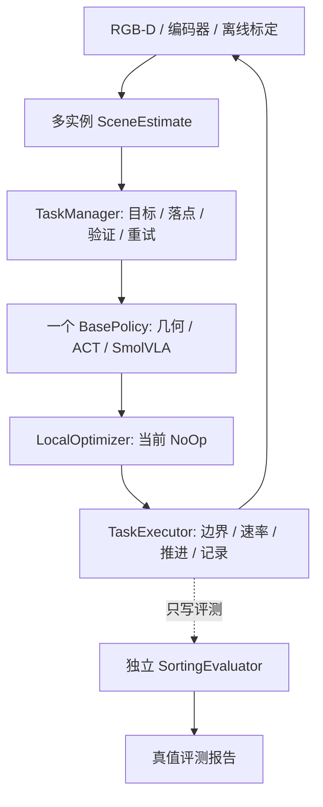

# 七物料任务与控制架构

## 控制边界

默认 `WorkstationEnv()` 和 CLI 使用 `sorting_basic`。`Executor` 根据任务选择
`TaskExecutor` 或显式旧任务适配器 `M1Executor`；仿真仍只有一个 `WorkstationEnv`，
机器人资产、执行器、积分设置及关节顺序均复用。旧架构记录见
[ARCHITECTURE_M1.md](ARCHITECTURE_M1.md)，旧标签 `v0.1.0-m1` 保留。

`contracts.py` 定义 `ObjectTrack`、`SceneEstimate`、`TaskGoal`、`BasePolicy`、
`LocalOptimizer`。TaskManager 管理整场库存、目标和预留落点；基础策略只执行当前单件目标。
同一时刻只选择一个基础策略。策略返回六维名义关节目标、阶段和状态；局部优化器仅添加修正，
不拥有推进仿真的权限。未知阶段和未列入 `enabled_phases` 的阶段禁止增强。

关节顺序为 Rotation/Pitch/Elbow/Wrist_Pitch/Wrist_Roll/Jaw，单位均为弧度。
归一化增量先以最大 0.05 rad 累加到当前控制目标，再裁剪执行器范围。
新执行器还限制局部修正为前五轴 ±0.02 rad、夹爪 ±0.05 rad，最终每步目标变化不超过
0.18 rad / 夹爪 0.5 rad。实际积分每步 33×0.002=0.066 s，沿用上游约 15 Hz 节奏。

ACT、SmolVLA 均实现 episode 重置、目标启动和动作接口，每次新目标清空模型和处理器缓存。
公开检查点仅声明 `pickplace_compat` 能力；七物料入口在下载/加载前明确拒绝未适配权重。
未来本地训练目录需要 `task_capabilities.json` 声明 `supported_tasks: ["sorting_basic"]`，
并包含匹配的 LeRobot 模型和处理器。语言、图像映射、归一化继续由检查点处理器负责。
当前不声称七物料学习策略已训练成功。

## 场景与采样

`scene.py` 在内存中参数化同一份 MJCF：7 个独立 `object_XXX` 自由物体，颜色是每回合属性，
不是实例 ID。24 mm 方块的颜色数量为随机排列的 3/2/2。三个容器外宽 120 mm、内半宽
52 mm，红/绿中心为 (-0.18,-0.13)/(0.18,-0.13) m，黄为 (0.22,-0.005) m。
每盘三个落点偏移 (-23,+23)/(+23,-23)/(-23,-23) mm，中心间距至少 46 mm。
扩大容器是为了三物料平铺和活动夹指净空；旧三物料和单物块配置不改。

源区半径 0.19–0.27 m、方位 -35–35°，最小中心间距 50 mm。整个场景最多重采样
40 次，每块最多尝试 600 次；检查托盘间距、IK 可达性及张开到闭合的夹指扫掠净空。
耗尽则明确记录 `reset_failed`，不减少物料数量。采样和离线标定允许使用初始化信息，
控制运行中重新从图像建立视觉 ID，不向控制器传递仿真物体 ID 或位置。

## 感知、抓放与恢复

固定相机输出 640×480 RGB-D，新场景 fovy=60° 以覆盖容器后缘；模型 RGB 相机仍为
224×224。球形标靶离线估计外参，RGB-D 反投影、RANSAC 桌面、颜色分类、DBSCAN
多聚类、约束 ICP 方块位姿估计均来自图像。容器内使用已知 6 mm 支撑平面，并拒绝明显
叠放或倾斜的高点簇。视觉 ID 由颜色约束的空间 Hungarian 关联维护，不复用仿真 ID。

初始化必须确认七个实例。已入盘物料继续检测并参与占位核验。几何策略按净空选择目标与
等价方块抓取方向，使用机器人 FK、固定容器和视觉邻近物料检查夹指扫掠；不查询动态物体
碰撞真值。预抓开度 0.4 rad、滑入距离 10 mm，减少活动夹指扫掠；
下探 TCP 为 28 mm，防止指尖压桌；闭合缓动，利用夹爪编码器识别抓空。
接近/抬升高度在边缘可达区域有明确低高度候选。入盘前对齐方块朝向，先从容器中心 85 mm 高位进入，再移向落点释放，
夹爪随后撤到高位侧向观察姿态。所有过程由单一执行器步进。

TaskManager 预留唯一落点。验证要求正确颜色位于预留区域、完整旋转轮廓入盘、夹爪撤离，
且三帧位置稳定；观测间隔 4 步即 0.264 s，满足至少 0.2 s。先前已完成落点也必须保持有效，
避免被碰动的旧物料重复计数。失败后释放确认空的预留，重观测、换方向，每件最多两次额外
重试。不确定但已占用的落点保持阻塞并明确失败，不再投放另一块。没有可行路径、持续
感知失败、重试耗尽或超时均结束该回合，执行器继续自动重置下一回合。

最终要求七个唯一完成记录、七个可一对一匹配的容器内实例、源区无剩余。重置清空速度、
物料布局/颜色、跟踪、预留、策略缓存、优化器和计时器；模型与渲染上下文复用。

## 非特权控制与记录

`RuntimeContext` 仅提供编码器派生 FK/IK、RGB-D 回调、标定和动作边界，没有 env、oracle、
接触或评测回调。`sorting_basic.step()` 也不以真值计算成功或奖励。运行时成功由视觉状态机
决定；独立评测器只读仿真状态，分别记录实际正确入盘、错分、掉落和环境碰撞。
真值审计不改变控制状态，误判同时保留 `perceived_success` 与 `gt_success`。

JSONL 轨迹包含视觉场景、episode/视觉目标 ID、完整 goal、阶段、名义动作、局部修正、
最终动作及前后编码器/TCP 状态。回合报告保留每次失败/重试事件、分项成功、时间、
策略/感知延迟及模型/渲染器身份；manifest 保存软件版本、源文件散列、Git 状态、标定和命令。
图像示范训练仍需下一阶段的数据采集与标签流程，当前状态轨迹不冒充完整训练数据集。

## 后续增强与资源

Residual SAC 优先声明 approach/align/close 阶段，学习有限局部修正和恢复。
世界模型增强器需重新采集抓取状态与短时后果数据，随后用于局部候选动作优化。
本阶段两者只提供接口和记录；M1 Reach 世界模型及其旧 hybrid 实验通过显式任务保留，
不称为已训练的抓取后果模型。

CLI 对物理 GPU 0 加文件锁，渲染和模型作业串行执行；CPU 运行物理。没有 ROS、分布式
服务或真机接口。`close()` 显式释放渲染资源。
