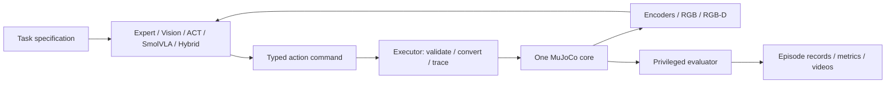

# Architecture

`WorkstationEnv` owns a single model/data pair. Its sorting and compatibility
scenes include the same vendored robot. `ReachEnv` and `LiftEnv` are privileged
Gymnasium views over this core. No learning wrapper maintains its own robot
asset or actuator convention.

## Observation and action boundaries

Joint order is Rotation, Pitch, Elbow, Wrist_Pitch, Wrist_Roll, Jaw. All six
dimensions, including the jaw, use radians. `ActionCommand` explicitly carries
absolute setpoints or normalized increments. Increments are accumulated against
the **last commanded setpoint**, with 0.05 rad maximum increment, then clipped to
actuator bounds. They are not added to measured joint positions.

The physics timestep is 0.002 s, with 33 substeps per nominal 15 Hz action,
matching upstream. Actual action duration is 0.066 s (15.1515 Hz). Reports retain
this distinction; LeRobot video metadata uses the upstream nominal 15 fps.

The policy context exposes robot-only scratch kinematics, sensor callbacks,
known fixed tray locations and offline estimated camera extrinsics. Only the
scripted expert receives the object-pose oracle. Vision and hybrid never receive
object truth or simulator segmentation. Robot scratch FK/IK does not step
physics. Privileged RL observations are clearly labeled, and contain actuator
setpoints to preserve Markov state.

## Sorting scene

Red and green trays are at (-0.18,-0.13) and (0.18,-0.13) m. The yellow tray is
at (0.23,0.0) m. Source blocks are sampled in the upstream polar region,
r=0.19–0.27 m and bearing=-20–35 degrees, with random square-symmetry yaw.
Sampling rejects overlaps, tray interference, and unreachable grasp/hover
points. Tray lowering and transport waypoints are verified at startup.

The final side tray layout was selected after a front tray obstructed the jaw
approach and exceeded the arm's constrained high-reach workspace. We preserve
the original arm dynamics and use reachable 8.5 cm transport/retreat waypoints.

## Closed-loop execution

All policies yield one command at a time. The executor alone advances physics
in task execution. Phase trajectories use the current actuator setpoint for
continuous interpolation. Controller changes are recorded with source, phase,
raw action and applied action. Each material has at most two retries. There is
no automatic expert fallback.

The initial hybrid uses calibrated color/geometry perception to choose a
pregrasp target, then CEM-MPC to move the empty, open gripper. IK handles final
orientation, slide-in grasp, lifting, transport and release. Vision checks
placement before proceeding. MPC warm starts are cleared per new subgoal;
model-free action queues reset per new episode. Timeout is an explicit failed
attempt, not a silent IK completion of the Reach stage.

During empty-hand MPC, the executor checks simulated moving-link contacts above
2 N with the table, materials or trays. Such contact aborts the subskill and
triggers an explicit re-observation/retry. This guard is simulation-specific;
it does not imply real force-sensor integration.

The world model is a small ensemble of three MLPs predicting normalized deltas
of joint positions, velocities and TCP. Control-setpoint evolution is computed
analytically. CEM searches 15-step sequences (256 candidates, 32 elites, four
iterations) using learned rollouts; it never calls MuJoCo. Training uses Reach
episodes from both home and sensing-rest poses, to cover hybrid startup.

## Capabilities and measurements

The public ACT-DR and SmolVLA-v2 checkpoints were trained on the original red
block / blue tray task. They run through checkpoint-owned normalization,
tokenization and camera-renaming processors. SmolVLA handles the optional third
camera using its own missing-camera behavior; the station supplies front and
wrist only. Sorting evaluation of these weights is an out-of-distribution
transfer experiment.

The strict evaluator requires the full rotated cube footprint inside the
assigned tray, a plausible resting height, low linear/angular velocity, and
the gripper above 7 cm for six consecutive control steps. Legacy upstream
success is recorded separately. Final reports include per-material and
whole-scene success, retries, execution duration, controller latency and
handover counts. Videos and traces are local, with selected demo clips published
separately.

## Resource ownership

The CLI selects the physical GPU before importing MuJoCo/torch, and takes a
local file lock per GPU for learning and rendering jobs. The validation script
runs them sequentially. CPU physics does not require a GPU. No distributed
training, ROS service, web dashboard or external experiment tracker is needed.
`close()` explicitly frees each rendering context.
