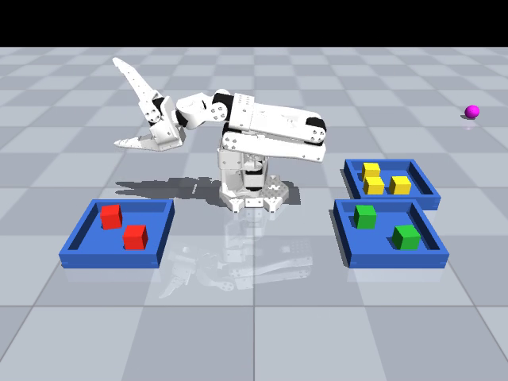
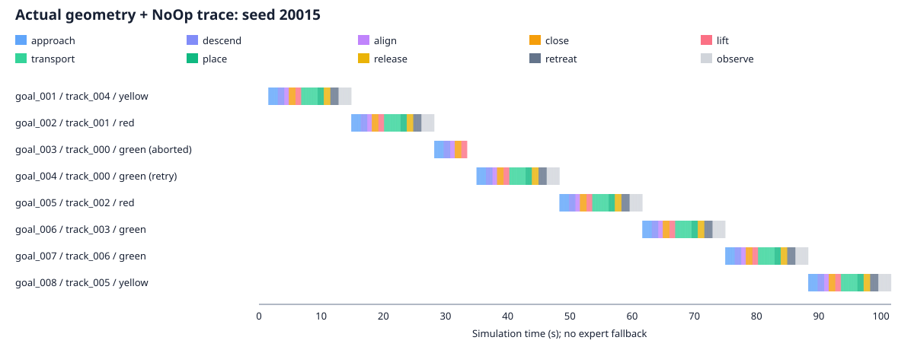

# 七物料独立验收报告

2026-11-02，控制代码提交 `f63cd51db4be9e9180330710b6263a465c0ffc40`。
固定控制逻辑后首次运行独立种子 20000–20019，20 场在同一进程连续执行，未剔除或重跑失败场景。

| 指标 | 实测 | 门槛 |
| --- | --- | --- |
| 整场七件正确分拣 | **20/20，100%** | 至少 18/20 |
| 单件正确入盘 | **140/140，100%** | 至少 133/140 |
| 错分 / 掉落 | **0 / 0** | 成功回合无错分 |
| 视觉整场误判 | **0** | 视觉与真值分别记录 |
| 失败抓取 / 额外重试 | **1 / 1** | 每件至多两次额外重试 |
| 专家兜底 | **0** | 不允许 |
| 模型 / RGB-D 渲染上下文 | **全 20 场复用同一实例** | 同一进程自动重置 |
| 真实渲染完整测试集 | **22 passed** | 包括禁止真值访问后的七物料完整分拣 |

完整逐回合结果、manifest、全部轨迹散列及独立检查结果：
[sorting_basic.json](results/sorting_basic.json)。检查脚本为 `scripts/acceptance_basic.py`。
完整状态轨迹留在本机 `outputs/basic/traces/`，数据和权重不进入 Git。

[完整首场视频，seed 20000](media/sorting_basic.mp4) · [初始七物料布局](media/sorting_basic_initial.png)



## 设置与方法

SO-ARM100，7 个 24 mm 方块，红/绿/黄数量是 3/2/2 的随机排列，每回合重新随机颜色、
位置和朝向。3 个 120 mm 容器，每个最多 3 个平铺落点。最小初始化物料中心间距 50 mm，
有界重采样检查抓取/容器可达性与活动夹指净空；不静默降低数量。形状、光照、摩擦固定。

运行时只使用 RGB-D、编码器、机器人 FK、离线球标定与固定容器几何。没有物体位姿
oracle、分割或接触真值控制。TaskManager 使用颜色约束的多实例跟踪、独立落点预留和
三次稳定视觉观测决定完成。独立审计器另外检查完整旋转轮廓、正确容器、稳定速度/高度
与夹爪撤离，不把结果反馈给任务状态机。默认基础策略是 `GeometricBasePolicy`，增强器
是 `NoOpOptimizer`；逐步轨迹证实修正恒为零，没有混合其他基础策略的动作。

源区与物料数量检查、占位、跟踪、关节/物体速度、策略缓存、优化器和计时器在回合间
自动清除。20 场复用同一 MuJoCo 模型与渲染实例，验收脚本逐项核对。

运行环境：Python 3.12.16、MuJoCo 3.17.0、NumPy 2.2.6、SciPy 1.18.1；
NVIDIA L40，物理 GPU 0，驱动 580.105.08，46,068 MiB 显存。
软件完整版本与源树快照散列在 manifest。标定残差 0.489 mm。所有 GPU 作业串行。

```bash
workcell calibrate
workcell evaluate --base-policy geometric --episodes 20 --seed 20000 --output outputs/basic --video
python scripts/acceptance_basic.py
```

## 恢复与时延

种子 **20015** 中，`track_000` 首次抓取后夹爪编码器显示抓空，任务管理器释放空落点、
重新观测并重新启动该目标，第二次完成。该回合仍按一场计入验收，并保留首次失败事件。
其余 19 场均一次处理完所有物料。



该图从真实动作记录导出，不是手绘示意：

```bash
python scripts/plot_basic_trace.py outputs/basic/traces/20015.jsonl docs/media/recovery.svg
```

平均每场 95.71 s 仿真时间、17.24 s 墙钟时间；总计 29,003 控制步，第一场包含视频编码。
名义控制节奏约 15 Hz，每步实际积分 0.066 s。几何策略 `act` 平均约 0.182 ms，
一次阶段触发的 RGB-D 感知平均约 480 ms（包含渲染与几何处理）。后者不是逐帧 15 Hz
实时视觉控制，整个仿真也没有按墙钟限速。

## 发现、回归与限制

开发种子 0–9 与上述验收集分开。开发期间保留了抓空、容器边缘碰撞、邻近物料被碰动、
视觉验证失败和无可行抓取方向等失败记录，位于本机 `outputs/basic-dev-*`。主要修正为：
扩大三落点容器、覆盖后缘的 RGB-D 视野、按方块宽度选择预抓开度、检查闭合中间角度、
提高抓取 TCP、在容器上方先高位进入，再向独立落点放置。未确认但已占用的落点会保持
阻塞并明确失败，避免继续向同一区域投料；这类盘内偏位恢复尚未实现。

独立审计仍记录 **779 个环境接触控制步**，每场 25–52 步：在每个控制步末采样移动
机械臂与非物料环境的接触法向力是否超过 2 N，预期夹爪/物料接触不计入。该值不是碰撞
次数，也不覆盖所有积分子步的冲量。本阶段没有实现零碰撞优化，不能从成功率推断零接触。

旧三物料视觉、公开 ACT 和 SmolVLA 的兼容任务各执行一次真实回归（seed 10000），
均完成；这是共享感知/CLI 变更的回归检查，不是新的学习策略性能结论。
[检查记录](results/basic_checks.json)。历史 M1 的 20 次完整评测原样保留在
[RESULTS.md](RESULTS.md) 和旧标签 `v0.1.0-m1`。

七物料 ACT/SmolVLA 尚未训练，入口对公开单物块权重明确报告尚未就绪。
Residual SAC 和抓取短时世界模型/MPC 只有增强接口与状态记录，没有本阶段训练结果。
固定规则方块、固定光照/摩擦与可达性筛选布局的 20 场是小型仿真验收集；没有形状、
遮挡、摩擦扰动、真机或跨本体泛化结论。后续增加这些实验时需另设测试集与对照。
